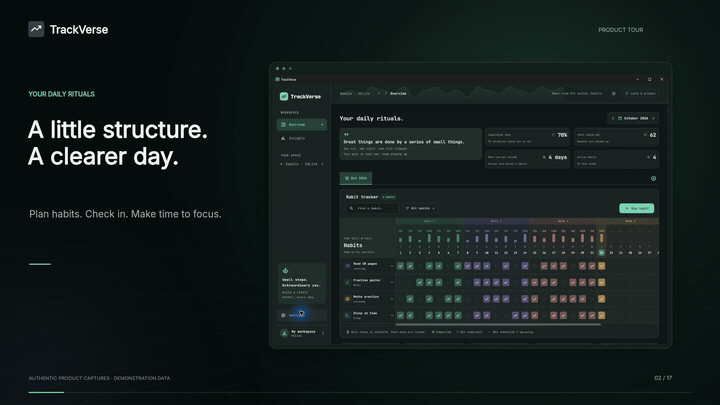

# TrackVerse

**Build better habits. Make time for what matters. Keep your data yours.**

TrackVerse is a local-first Windows habit tracker with a spreadsheet-style workspace, habit-linked Pomodoro timer, automatic progress dashboards, and optional Google Sheets backup. Your everyday work is saved in native SQLite, including when you are offline.

**Current release: 2.0.0 · Windows x64 MSI/MSIX and Android test APK**

**Trusted signing is pending. Smart App Control may still block this application.**

[Download Windows MSI](https://github.com/Its-Vaibhav-2005/TaskVerse/releases/latest) · [Website](https://its-vaibhav-2005.github.io/TaskVerse/) · [Theme showcase](https://its-vaibhav-2005.github.io/TaskVerse/themes.html) · [Changelog](CHANGELOG.md) · [Privacy policy](https://its-vaibhav-2005.github.io/TaskVerse/privacy.html)

## Explore

- [Key features](#key-features)
- [Install and get started](#install-and-get-started)
- [Habits and monthly planning](#habits-and-monthly-planning)
- [Pomodoro and focus time](#pomodoro-and-focus-time)
- [Dashboards and calculations](#dashboards-and-calculations)
- [Themes and typography](#themes-and-typography)
- [Google Sheets and backups](#google-sheets-and-backups)
- [Privacy and security](#privacy-and-security)
- [Development and packaging](#development-and-packaging)

## Key features

| Feature | What you can do |
| --- | --- |
| Spreadsheet-style habit tracker | Check off today's habits in a clean grid with pinned habit names, colored week bands, daily completion bars, search, and category filters. |
| Flexible schedules | Choose repeat weekdays, a category, an icon, a color, and which month tabs contain a habit. |
| Daily targets and reminders | Set a target from 1–99, record partial progress, and edit reminder times and repeat intervals. |
| Monthly workspaces | Create tabs such as **Oct 2026**, reuse the previous plan or start fresh, and remove future months. |
| Automatic progress | See completion rate, total check-ins, current streaks, active habits, weekly summaries, and a consistency curve. |
| Habit-linked Pomodoro | Customize work and break durations; start, pause, resume, and save time against a specific habit. |
| Floating timer | Keep a compact, resizable timer above ordinary application windows, with smooth circular wave animation. |
| Focus Insights | See total time invested and a donut chart divided by habit colors. |
| 43 theme presets | Browse searchable previews, with paired light and dark palettes for every preset. |
| System appearance | Follow Windows light/dark settings automatically, or choose a manual mode. |
| Typography controls | Choose bundled fonts and adjust the overall text size one point at a time. |
| Offline SQLite storage | Work locally without an account or internet connection. |
| Optional Google backup | Sign in to create private backup spreadsheets automatically and recover synced data later. |
| Multiple cloud trackers | Switch between regular habits, exam preparation, or other separate plans with named trackers. |
| Portable backups | Export and restore habits, monthly plans, check-ins, and focus sessions as JSON. |
| Organized Settings | Manage appearance, typography, trackers, backups, and daily behavior in responsive grouped cards. |

### New in 2.0.0

Android now has a native phone interface, Google sign-in, a consistency curve, and Settings → Create tracker. Trackers stay separate and share the Windows versioned Google Sheets backup protocol. Pending changes in inactive Android trackers are retried while the app is open. The Android download is debug-signed for testing; the MSIX is unsigned Store submission input. See the [full changelog](CHANGELOG.md).

## Install and get started

1. Download the Windows x64 MSI and checksum from [Releases](https://github.com/Its-Vaibhav-2005/TaskVerse/releases/latest).
2. Run the installer and open TrackVerse from the Start menu or desktop shortcut.
3. Choose **Setup Locally** for SQLite-only use, or **Continue with Google** for SQLite plus optional cloud backup.
4. Click **New habit**, enter a name, select its schedule, appearance, daily target, and optional reminder settings, then create it.
5. Click today's scheduled cell to record progress; use the count controls for habits with a daily target above one.
6. Use the month-bar **+** to plan another month, or open **Widgets → Pomodoro** to focus on a habit.

New installations start without sample habits or personal account credentials. The 2.0.0 MSI and application are unsigned and can be blocked by Smart App Control. Keep Windows protection enabled. For upgrades, export a backup first, quit TrackVerse including its tray process, and install the newer release using the same Windows account and scope. User data is stored separately from installation files. Upgrade identity is preserved; clean-machine upgrade acceptance remains pending.

To verify the installer, compare this PowerShell result with the checksum supplied alongside your download:

```powershell
Get-FileHash .\TrackVerse-Setup-2.0.0-x64.msi -Algorithm SHA256
```

### Watch the walkthrough

[](https://its-vaibhav-2005.github.io/TaskVerse/#walkthrough)

[Watch with audio, captions, and chapters](https://its-vaibhav-2005.github.io/TaskVerse/index.html#walkthrough) · [Download the cinematic MP4](https://its-vaibhav-2005.github.io/TaskVerse/media/TrackVerse-Cinematic-1080p.mp4) · [English captions](https://its-vaibhav-2005.github.io/TaskVerse/media/TrackVerse-Cinematic.srt) · [Narration transcript](https://its-vaibhav-2005.github.io/TaskVerse/media/TrackVerse-Cinematic-Transcript.md)

The **6-minute-46-second cinematic demo and tutorial** is exported at **1920 × 1080, 30 FPS**, with English neural narration, original music, captions, and 32 embedded chapters. It uses authentic application captures and demonstration data to explain local setup, habit creation, daily targets and reminders, partial progress, today's check-in, search and category filters, habit management, monthly planning, dashboard calculations, Pomodoro controls, the floating timer, Focus Insights, themes, typography, portable backups, and optional Google-connected tracker tools. Google-connected actions require the viewer's own sign-in. The website includes chapter buttons for jumping to the main tutorial steps. The animated preview is silent; open the full video for narration.

## Habits and monthly planning

### Create and organize habits

Choose a habit name, repeat weekdays, category, icon, and color. Search and category filtering sit beside **New habit** in the tracker toolbar. The habit's **…** menu offers editing and deletion, with confirmation before deletion.

TrackVerse includes **26 icons, 16 categories, and 16 habit colors**:

- **Icons:** Reading, Water, Mindfulness, Running, Bedtime, Writing, Coding, Wellness, Maths, Languages, Music, Entertainment, Gaming, Cooking, Trading, Sleep, Gym, Hygiene, Art, Piano, Science, Pets, Cleaning, Cycling, Savings, and Work.
- **Categories:** Wellness, Learning, Mindfulness, Fitness, Creativity, Personal, Entertainment, Gaming, Hygiene, Cooking, Finance, Languages, Music, Sleep, Work, and Relationships.
- **Colors:** Choose from the built-in palette to distinguish habits throughout the grid and focus-time chart.

### Plan each month

When adding a month, choose its month/year and either **Use same habits** from the nearest earlier month or **Start fresh**. When creating an additional habit, choose **This month only** or **All months**; the latter assigns it to all existing month tabs.

Month membership is independent, while copied habits retain the same identity and history. Editing a shared habit's name or schedule affects that habit wherever it is assigned. Deleting a habit removes its check-ins across its assigned months; recorded historical focus time is retained.

Only **future month tabs** can be deleted. Current and past months are protected, including by native SQLite date validation. A new current-month tab is added automatically at a month boundary if needed. Connected Google trackers mirror these month tabs into their spreadsheets.

### Daily check-in rules

Only today's scheduled cells can be marked or unmarked. Past and future dates, unscheduled weekdays, and dates before habit creation are locked. Saved past completions remain visible.

### Daily targets and reminders

In **New habit** or **Edit habit**, choose a **Daily target** from 1–99 times.
Habits with a target above one show progress such as **3/8** in the grid. Click
today's cell, adjust the count with **+ / −**, then choose **Save progress**.
Only reaching the target completes the day for rates and streaks. Existing
habits keep their single-check behavior and saved history.

Turn on **Remind me**, choose the **First reminder** time and **Repeat every**
interval. Edit either setting later through the habit's **… → Edit habit** menu.
Windows notifications repeat on scheduled days until today's target is reached
or the day ends. An edited schedule takes effect on the next reminder check
(within about 15 seconds). Counts and reminder settings are included in backups.

When reminders are enabled, closing the window keeps TrackVerse in the Windows
system tray. Double-click its tray icon to reopen it, or use **Quit TrackVerse**
to stop it. Open the app again after restarting Windows; this feature does not
enable startup automatically. Windows notification settings and Do Not Disturb
can suppress alerts. Browser previews save reminder settings; native Windows
notifications are provided by the desktop app.

TrackVerse reads your device's local date, refreshes at midnight and on resume, and responds to clock changes. The native database checks the date again before writing a check-in, so an overnight-open screen cannot edit yesterday.

## Pomodoro and focus time

Open **Widgets → Pomodoro** in the sidebar, choose a habit, and set your durations.

| Control | Behavior |
| --- | --- |
| Work duration | 1–180 minutes; defaults to 25 minutes. |
| Break duration | 1–60 minutes; defaults to 5 minutes. |
| Start / pause / resume | Control the current phase without counting paused time. |
| Finish / reset | Save elapsed work time and reset before changing the habit or durations. |
| Phase completion | The next phase is prepared paused; start it when you are ready. |
| Compact / expanded view | Switch between configuration and the floating mini timer. |
| Close widget | Hide the widget; the timer continues while the main application remains running. |

The timer uses the application's palette and typography, a smooth circular wave, a progress ring, and a progress bar. Pausing freezes its animation, and reduced-motion preferences are respected. The full configuration widget has fixed dimensions without an internal scrollbar; the compact timer is resizable. The native floating window reasserts its always-on-top position without stealing focus.

Actual work time is checkpointed to SQLite every five seconds and on pause/reset. Breaks and paused time are excluded. After an interrupted application session, recovery starts paused and does not count time while the application was closed. An abrupt termination can lose the few seconds since the latest checkpoint.

An active session stays attached to its original tracker when you switch trackers. Deleting that tracker or replacing its data through restore is blocked until the session is finished. **Focus time and habit completion are separate:** using the timer does not automatically mark a daily check-in.

## Dashboards and calculations

The workspace places a compact motivation card beside a **2 × 2 KPI grid**, followed by month controls and the habit tracker. The full consistency curve and **Today, at a glance** appear below the grid. A subtle copy of the consistency curve also forms the navbar background without increasing its height.

| Metric | Calculation or meaning |
| --- | --- |
| Completion rate | Completed scheduled check-ins ÷ scheduled opportunities through today. Future days and dates before habit creation are excluded. |
| Total check-ins | Recorded completions for the selected month's habits. |
| Best current streak | Consecutive scheduled days completed. An incomplete today does not break the streak until the day ends. |
| Active habits | Habits assigned to the selected month. |
| Weekly summaries | Progress in groups of days 1–7, 8–14, and so on. |
| Consistency curve | Daily completion across the selected month. |
| Today, at a glance | Completion for the actual current date, even when another month is selected. |
| Focus Insights | Recorded work time, with a habit-colored donut showing how that time is distributed. |

## Themes and typography

### Appearance modes

New profiles default to **System**, following Windows light/dark preferences automatically. Choose **Light** or **Dark** to override it. Preferences persist locally; existing manual choices are retained during upgrades.

Every preset has paired light and dark palettes. The palette and appearance mode are independent—even a preset with “Dark” in its name has a light counterpart. Settings, dialogs, the sidebar, charts, and timer share the selected palette. Habit colors remain distinct semantic choices. The neutral charcoal application icon works across all presets.

Open **Settings → Appearance → Browse 43 themes** to search by name or collection and preview miniature workspaces. You can also [explore the interactive theme showcase](https://its-vaibhav-2005.github.io/TaskVerse/themes.html).

### All 43 presets

These are original, name-inspired palettes, not official ports or endorsements by the referenced brands or theme projects. The catalog includes the native TrackVerse palette plus 42 additional presets.

| Theme | Collection | Light accent | Dark accent |
| --- | --- | --- | --- |
| TrackVerse | Native | `#32816a` | `#7ad5b0` |
| Vercel | Tech & brand | `#171717` | `#ededed` |
| Stripe | Tech & brand | `#635bff` | `#a99afa` |
| Linear | Tech & brand | `#625ac4` | `#a5a1ff` |
| Claude Light | Tech & brand | `#a85132` | `#e6aa8b` |
| Claude Dark | Tech & brand | `#a05336` | `#d99a7c` |
| Tokyo Night | Editor classics | `#3453a0` | `#7aa2f7` |
| Tokyo Night LD | Editor classics | `#3b5ea6` | `#89b4fa` |
| Dracula | Editor classics | `#7541aa` | `#bd93f9` |
| Dracula Official | Editor classics | `#a32371` | `#ff79c6` |
| Dracula LD | Editor classics | `#6f4ba7` | `#a998ef` |
| Nord | Editor classics | `#30647b` | `#88c0d0` |
| Nord LD | Editor classics | `#306d70` | `#8fbcbb` |
| Catppuccin Mocha | Editor classics | `#7848a8` | `#cba6f7` |
| Catppuccin | Editor classics | `#8839ef` | `#f5bde6` |
| Gruvbox | Editor classics | `#875a08` | `#fabd2f` |
| Gruvbox Dark | Editor classics | `#607013` | `#b8bb26` |
| One Dark Pro | Editor classics | `#2465a0` | `#61afef` |
| One Dark | Editor classics | `#406a28` | `#98c379` |
| GitHub Dark | Editor classics | `#0969da` | `#58a6ff` |
| GitHub Light | Editor classics | `#0969da` | `#79c0ff` |
| Everforest | Editor classics | `#536a31` | `#a7c080` |
| Solarized Dark | Editor classics | `#16746e` | `#3aa8a0` |
| Solarized Light | Editor classics | `#876300` | `#c7a847` |
| Monokai | Editor classics | `#4d6c09` | `#a6e22e` |
| Rose Pine | Editor classics | `#a34d6c` | `#ebbcba` |
| Ayu | Editor classics | `#926004` | `#ffb454` |
| Cobalt2 | Editor classics | `#1a6096` | `#ffc600` |
| Cobalt Gold | Editor classics | `#886211` | `#e9bd59` |
| Midnight Purple 2077 | Editor classics | `#8134b6` | `#d7a0ff` |
| Celestial Mage | Dream skins | `#6651a5` | `#c3b3ff` |
| Interstellar Crossing | Dream skins | `#136b85` | `#6bdfed` |
| Neon Moon Pavilion | Dream skins | `#973b90` | `#ee9ee8` |
| Sakura Sports Car | Dream skins | `#a8325c` | `#ff9dbb` |
| Snow Country Cabin | Dream skins | `#346d82` | `#b6dce6` |
| Sunlit Summer Sky | Dream skins | `#26709a` | `#f4d77d` |
| White Night and Solace | Dream skins | `#596a9a` | `#b9c5ee` |
| Blushing Muse | Dream skins | `#a54667` | `#edb0bd` |
| Obsidian Gold | Community & native | `#80631a` | `#e4bf71` |
| Cosmic Red | Community & native | `#b3324c` | `#ff9aab` |
| Nebula Velvet | Community & native | `#7d4aa2` | `#c6a0ea` |
| Sage Serenity | Community & native | `#4a6b3b` | `#b5cba4` |
| Digital Melody | Community & native | `#20726b` | `#79d5d0` |

The light and dark accent columns show each preset's main interface accent. Each palette also defines its own backgrounds, surfaces, borders, selected states, and readable text colors. The shared catalog lives in [assets/themes.json](assets/themes.json).

### Fonts and text size

In **Settings → Typography**, choose **Inter**, **Lora**, or **JetBrains Mono**. Increase or decrease the overall font size one point at a time, from **−2 to +4** relative to the default. A live preview helps you choose; reset restores Inter at its default size.

Fonts and their open-source licenses are bundled for offline use. Light-mode text uses stronger contrast, and the layout accommodates larger text. Theme generation checks primary, secondary, and accent-label contrast.

## Google Sheets and backups

### Choose your storage setup

| Setup | Storage | Account needed? |
| --- | --- | --- |
| Setup Locally | Native SQLite on your Windows device; optional manual JSON exports. | No |
| Continue with Google | The same local SQLite workflow plus optional private Google Sheets backup and recovery. | Google account |

Google sign-in creates backup sheets automatically—there is no need to paste links or enable “Anyone with the link.” TrackVerse requests basic identity information and per-file Drive access (`drive.file`) for files it creates or that you explicitly open with it.

Use **Settings → Trackers & cloud backup** to create or find cloud trackers, rename their aliases, switch trackers, open a sheet, sync, or delete a tracker and its sheet. Separate cloud trackers each have their own local SQLite data and spreadsheet, so regular habits and exam plans can stay separate.

Your Google profile name/photo appears when available. **Online / Offline** reflects internet reachability and updates within about 15 seconds; it is separate from a tracker's backup status. Being online alone does not mean every edit has finished syncing.

### What sync includes

Habits, check-ins, month assignments, and focus sessions are included in backup snapshots. Readable month tabs such as **Oct 2026** are generated with scheduled checkboxes, completion formulas, and daily charts. These tabs are views of application data: manually editing their cells does not import check-ins into TrackVerse.

Offline changes remain local and queued for later synchronization. Versioned backup history verifies snapshot integrity and tracks parent versions for conflict handling. Permission or network failures preserve local data; unresolved conflicts require attention rather than silently replacing another version.

### Recover after reinstalling

1. Open TrackVerse and choose **Continue with Google**.
2. Sign in with the same Google account used for your backups.
3. Use **Find my trackers** and select the tracker you want to recover.

Recovery restores data that successfully synced. Unsynced offline changes require the original local database or a manual export. Appearance preferences are local and are not part of tracker backup snapshots.

### Export, restore, and delete

- **Export backup:** Save a JSON copy of habits, check-ins, months, and focus sessions from Settings.
- **Restore backup:** Replace the active tracker's data after confirmation; database restore is transactional.
- **Delete tracker & sheet:** After confirmation, move the spreadsheet to Google Drive's Trash and archive its local database. The base local tracker is retained.
- **Reconnect a deleted sheet:** Restore it in Drive, then use **Find my trackers**.
- **Disconnect Google:** Remove saved account tokens without deleting local habits or the spreadsheets.

Installed user data normally lives under `%APPDATA%\trackverse`; development profiles use `.local-data/`. Tracker databases are separate from installation files. Archived deleted trackers live in the profile's `deleted-trackers/` directory. Keep exports somewhere safe outside the application folder.

## Privacy and security

- TrackVerse has no application backend, advertising, or analytics. Optional Google connections communicate directly with Google services.
- Windows Google account tokens are encrypted using the operating system's secure storage. Tokens are never shipped in the installer or transferred between users.
- Local SQLite databases and exported JSON backups are **not encrypted**. Google snapshot compression/encoding is not end-to-end encryption.
- Desktop authentication uses PKCE, state validation, and a loopback callback. Each user authorizes their own account.
- The installed-app OAuth client configuration is public client metadata and cannot be confidential inside a distributed application. It is distinct from personal access/refresh tokens. Service-account keys are not accepted for releases.
- The Electron renderer is sandboxed, uses context isolation, has no Node access, and communicates through a restricted native bridge.
- Release packaging excludes development databases, exports, token vaults, sample fixtures, tests, and local profiles. New users start with clean data.
- Credentials, `.config/`, `.local-data/`, generated builds, and database files are excluded from source control. Never commit personal credentials or user data.

Read the [privacy policy](https://its-vaibhav-2005.github.io/TaskVerse/privacy.html) for more information.

### Release validation

Version 2.0.0 is checked by the desktop, Flutter, release-policy and cross-platform sync integration suites, with a clean Flutter analyzer and a successful web build. The MSI keeps the existing upgrade identity. This package is unsigned; the required signature and publisher audit cannot pass until signing credentials are configured.

The 2.0.0 installer is distributed unsigned because signing credentials are not configured on the build host. The separate unsigned-package audit checks the MSI version, existing upgrade identity, required packaged features, private-data exclusions, SHA-256, and Authenticode status; Windows signature verification and trusted-publisher audit were not performed. SignPath approval remains pending. WiX ICE validation is disabled because the build host policy blocks it. Clean-machine installation, upgrade, and Smart App Control acceptance remain unverified. These checks are not a security certification.

## Development and packaging

### Stack and platform status

| Component | Technology |
| --- | --- |
| Interface | Flutter, bundled locally as web assets |
| Windows desktop shell | Electron with restricted preload/IPC |
| Native persistence | Node's native SQLite engine |
| Cloud backup | Google OAuth and per-file Drive/Sheets integration |
| Installer | Windows x64 MSI |

**Windows x64 is the released target.** Android now has a native Flutter mobile interface, local SQLite persistence, portable backups, a focus timer, and a Google Sheets sync implementation compatible with the Windows backup journal. Google OAuth clients are registered for this host’s debug certificate, and the owner confirmed account sign-in working. See [Android setup, builds, and acceptance](docs/android.md). The Android APK is distributed as a debug-signed test build. Linux remains scaffolding for future work. A browser preview uses browser storage and is not the native Windows SQLite application.

### Run from source

Use Node 24+ and Flutter stable:

```powershell
npm ci
flutter pub get
flutter build web --no-web-resources-cdn
.\Start-TrackVerse.ps1
```

You can also use `Start TrackVerse.cmd`. Rebuild web assets after Dart changes; restart the desktop application after desktop JavaScript changes.

Google development setup requires your own desktop OAuth client in ignored `.config/google-client.json`, with the Sheets and Drive APIs enabled. The application requests `openid`, `email`, `profile`, and `drive.file`. Keep this configuration and personal tokens out of Git history.

### Validate changes

```powershell
flutter analyze
flutter test
npm run test:desktop
npm audit --omit=dev
```

Coverage includes schedules, streaks, date locks, monthly assignments, responsive layouts, SQLite persistence and rollback, focus-session accounting/recovery, theme behavior, and backup/sync handling.

### Build a Windows installer

```powershell
flutter build web --no-web-resources-cdn
npm run dist:win -- --config.directories.output=dist/signed-release
npm run audit:release -- dist/signed-release
```

Configure a publicly trusted signing identity using the [Windows signing guide](docs/windows-signing.md) before producing a signed release. The 2.0.0 MSI is an explicitly unsigned build because no signing identity is configured on this host; its package contents and upgrade identity are checked separately, but the signed release audit cannot pass. Keep Windows security protections enabled. The assisted per-user installer creates desktop and Start menu shortcuts. Building does not publish a release to GitHub. Run `npm run test:release` to check the signing configuration rules.

For the documented unsigned 2.0.0 build, use the separately named commands `npm run dist:win:unsigned -- --config.directories.output=dist/release-2.0.0` and `npm run audit:release:unsigned -- dist/release-2.0.0`. The unsigned configuration does not change the default signed release path.

### Build a Microsoft Store MSIX

Save the exact Store Product identity values in ignored `.config/msix-identity.json`,
then run `npm run dist:win:msix` on Windows. This recipe runs every desktop,
release-policy and Flutter test, Flutter analysis, and a fresh web build before
packing. The clean MSIX, checksum, manifest, and verification report are saved in
`release-2.0.0/`. See [MSIX setup and acceptance](docs/windows-msix.md).

This is an unsigned Store-submission package; Microsoft signs it after
certification. It does not replace the existing MSI automatically. Export/import
a backup when migrating, and verify the data in the Store app.

### Theme catalog and demo data

`node tool/build-theme-catalog.cjs` regenerates the shared theme definitions used by Flutter and the native widget. Keep generated catalog changes together when modifying themes.

`tool/create-focus-demo.cjs` is a development-only fixture generator with an isolated profile; it refuses to overwrite an existing database. It is not a normal application feature and is excluded from the MSI.

### Source map

| Location | Purpose |
| --- | --- |
| `lib/main.dart` | Screens, dialogs, and application actions |
| `lib/model.dart` | Dates, schedules, completion, and streak calculations |
| `lib/tracker_grid.dart` | Spreadsheet-style habit grid |
| `lib/settings_page.dart` | Organized Settings interface |
| `lib/appearance.dart`, `lib/theme_gallery.dart` | Appearance controls and theme previews |
| `assets/themes.json`, `lib/theme_catalog.dart` | Shared theme catalog and generated Flutter palettes |
| `lib/focus_insights.dart` | Habit focus-time visualization |
| `desktop/main.cjs`, `desktop/preload.cjs` | Desktop windows and restricted native bridge |
| `desktop/database.cjs`, `desktop/workspaces.cjs` | SQLite storage and tracker management |
| `desktop/pomodoro.cjs`, `desktop/pomodoro.html` | Timer engine and widget interface |
| `desktop/focus-window.cjs` | Floating-window sizing and positioning |
| `desktop/google-auth.cjs`, `desktop/google-sheets.cjs` | Google sign-in and spreadsheet integration |
| `desktop/sync-engine.cjs`, `desktop/sheet-journal.cjs` | Synchronization and versioned backup history |
| `tool/validate-release.cjs`, `tool/audit-release.cjs` | Release preflight and package inspection |
| `website/` | GitHub Pages homepage, theme gallery, privacy policy, and video |

## Feedback

Report bugs or request improvements in [GitHub Issues](https://github.com/Its-Vaibhav-2005/TaskVerse/issues). Include your TrackVerse version, Windows version, and steps to reproduce. Remove personal data, backup contents, and credentials before sharing logs or screenshots.


## Code signing policy

TrackVerse's own source is available under the [MIT License](LICENSE). Third-party dependencies and fonts retain their original licenses. See the [Code signing policy](CODE_SIGNING.md) for unsigned release status and preparation for the free SignPath Foundation program. No application has been approved and no SignPath signature has been issued.
